<!--
  GENERATED FILE — do not edit by hand.
  Built by scripts/build.py from the weion.dev Pages CMS content and WakaTime feeds;
  .github/workflows/build.yml refreshes it daily.
-->

<a href="https://weion.dev"></a>

  

  
  
  

 


<b><code>// SERVICE RECORD</code></b> — 13 entries · expand

 


 



 


<a href="https://ctrl-alt-elite-java-journal.netlify.app"></a>

  

<a href="https://habit-tracker-project-two.netlify.app"></a>

  

<a href="https://q1-fp.netlify.app"></a>

  

<a href="https://www.enviromates.co.uk"></a>

  

 


<a href="https://weion.dev/#telemetry"></a>

 
 

  
  
  

 

