<a href="https://weion.dev">
  
</a>

<p align="center">
  <a href="https://weion.dev"> INITIATING REMOTE LINK ........"/></a>
</p>

<p align="center">
  <a href="https://weion.dev"></a>
  <a href="https://www.linkedin.com/in/terryfallows/"></a>
  <a href="mailto:terry@weion.dev"></a>
</p>

<br/>


| FIELD           | VALUE                               |
| :-------------- | :---------------------------------- |
| **CODENAME**    | `WEION`                             |
| **DESIGNATION** | `SENIOR SOFTWARE ENGINEER`          |
| **AFFILIATION** | `VANTIVA`                           |
| **LOCATION**    | `EARTH // SOL SYSTEM`               |
| **STATUS**      | 🟢 `ACTIVE`                         |

I have always been fascinated with technology and development in computing; there is so much potential to create marvels that have the potential to change our lives for the better. Coding is about solving one big problem and once I do, the feeling drives me to become better.

Outside of work I love gaming, particularly tabletop role-playing games such as Dungeons and Dragons which I try to play every week — I also enjoy reading sci-fi novels while I am travelling.

```text
// KNOWN ASSOCIATES
  ▸ WEEKLY TTRPG COHORT ........ Pathfinder 2e and Gumshoe
  ▸ READING DOSSIER ............ The Expanse, Halo, Warhammer 40k

// INTERCEPTED TRANSMISSION
  ▸ Q: What kind of web developers *do* like bugs?
  ▸ A: Spiders.
```

<details>
<summary><b><code>// SERVICE RECORD</code></b> — expand</summary>

```text
2025-09 → PRESENT   SENIOR SOFTWARE ENGINEER ......... VANTIVA           SHIPLEY, UK · REMOTE
2024-01 → 2025-09   SOFTWARE ENGINEER ................ VANTIVA           SHIPLEY, UK · REMOTE
2023-02 → 2024-01   SOFTWARE ENGINEER ................ COMMSCOPE         SHIPLEY, UK · REMOTE
2022-05 → 2022-12   TECH TRAINEE → SOFTWARE ASSOCIATE  LA FOSSE ACADEMY  LONDON, UK · REMOTE
2018-01 → 2022-05   CUSTOMER CARE · CASE MGMT · WFM .. BT                ACCRINGTON, UK
2017-03 → 2017-10   WEB DEVELOPER .................... FREELANCE         BURNLEY, UK · REMOTE

// TRAINING
2020    → PRESENT   SOFTWARE ENGINEERING & COMPUTING . OPEN UNIVERSITY
```

</details>

<br/>


**`// CORE MODULES`**

<p>
  
  
  
  
  
  
  
  
  
</p>

**`// AUXILIARY SYSTEMS`**

`NODE.JS` `EXPRESS` `C++` `C#` `XAML` `MVVM` `SSH` `WSL` `HYPER-V` `GHIDRA` `RASPBERRY PI` `GIT` `GITHUB PAGES` `WEBSOCKETS` `RESTFUL API` `CORS` `OAUTH` `JSON` `NOSQL` `SQL` `SASS` `CSS` `REGEX` `SEO` `WEB COMPONENTS` `SSR` `DATA BINDING` `NPM` `JEKYLL` `HEROKU` `BROWSERIFY` `FTP` `SCP` `YAML` `TOML` `ESNEXT` `CI` `OOP` `PROCEDURAL`

<br/>



| ID | OPERATION | BRIEFING | INTEL |
| :-- | :-- | :-- | :-- |
| `01` | **[Chatté Latté](https://ctrl-alt-elite-java-journal.netlify.app)**<br/>`JAVA-JOURNAL` | Anonymous social media platform dedicated to the greatest beverage in a coder's arsenal — Java.<br/><sub>`REACT · NODE · EXPRESS · MONGO`</sub> | [LIVE](https://ctrl-alt-elite-java-journal.netlify.app) · [FE](https://github.com/theweion/fp-lap1-journaling-website-frontend) · [BE](https://github.com/theweion/fp-lap1-journaling-website-backend) |
| `02` | **[Habi-TraX](https://habit-tracker-project-two.netlify.app)**<br/>`HABIT-RECON` | An easy-to-use app that tracks daily habits and helps users do them better through streaks and reinforcement.<br/><sub>`REACT · NODE · MONGODB`</sub> | [LIVE](https://habit-tracker-project-two.netlify.app) · [FE](https://github.com/Tari38/Tari38-fp_lap2_project_client) · [BE](https://github.com/theweion/fp_lap2_project-server) |
| `03` | **[Quizmasters 1](https://q1-fp.netlify.app)**<br/>`Q1-RACE-SIM` | Online quiz game that introduces gamification principles in the form of a racing simulator.<br/><sub>`REACT · SOCKET.IO · NODE`</sub> | [LIVE](https://q1-fp.netlify.app) · [FE](https://github.com/theweion/Q1-quiz-game) · [BE](https://github.com/theweion/Q1-quiz-game-server) |
| `04` | **[EnviroMates](https://www.enviromates.co.uk)**<br/>`ENVIRO-NET` | Social platform encouraging users to clean their local communities — become an EnviroMate.<br/><sub>`REACT · NODE · EXPRESS · MONGO`</sub> | [LIVE](https://www.enviromates.co.uk) · [FE](https://github.com/TommyHacker/enviromates-client) · [BE](https://github.com/theweion/Enviromates_backend) |

> [!TIP]
> Video feeds for every operation are on file at **[weion.dev/#archive](https://weion.dev/#archive)**.

<br/>


<p align="center">
  
  
</p>

<p align="center">
  
</p>

<br/>


Open channel for collaborations, questions, or a good sci-fi recommendation.

<p>
  <a href="https://weion.dev"></a>
  <a href="https://github.com/TheWeion"></a>
  <a href="https://www.linkedin.com/in/terryfallows/"></a>
  <a href="mailto:terry@weion.dev"></a>
</p>

 END OF FILE · CONNECTION TERMINATED" width="100%"/>
