<!--
  GENERATED FILE — do not edit by hand.
  Built by scripts/build.py from the weion.dev Pages CMS content and WakaTime feeds;
  .github/workflows/build.yml refreshes it hourly and on CMS edits.
-->

<a href="https://weion.dev"><picture><source media="(prefers-color-scheme: dark)" srcset="./assets/dark/banner.svg"/><source media="(prefers-color-scheme: light)" srcset="./assets/light/banner.svg"/></picture></a>

  <a href="https://weion.dev"><picture><source media="(prefers-color-scheme: dark)" srcset="https://readme-typing-svg.demolab.com?font=Share+Tech+Mono&amp;size=16&amp;duration=1800&amp;pause=500&amp;color=F5A623&amp;center=true&amp;vCenter=true&amp;width=640&amp;repeat=false&amp;lines=%3E+INITIATING+REMOTE+LINK+........;%3E+ESTABLISHING+SECURE+CHANNEL+........;%3E+DECRYPTING+OPERATOR+PROFILE+........;%3E+PROFILE%3A+FALLOWS%2C+T.+%E2%80%94+CLEARANCE+GRANTED;%3E+WEION.DEV+%2F%2F+ACCESS+GRANTED.+WELCOME."/><source media="(prefers-color-scheme: light)" srcset="https://readme-typing-svg.demolab.com?font=Share+Tech+Mono&amp;size=16&amp;duration=1800&amp;pause=500&amp;color=B86A00&amp;center=true&amp;vCenter=true&amp;width=640&amp;repeat=false&amp;lines=%3E+INITIATING+REMOTE+LINK+........;%3E+ESTABLISHING+SECURE+CHANNEL+........;%3E+DECRYPTING+OPERATOR+PROFILE+........;%3E+PROFILE%3A+FALLOWS%2C+T.+%E2%80%94+CLEARANCE+GRANTED;%3E+WEION.DEV+%2F%2F+ACCESS+GRANTED.+WELCOME."/></picture></a>

  <a href="https://weion.dev/#archive"><picture><source media="(prefers-color-scheme: dark)" srcset="./assets/dark/btn-console.svg"/><source media="(prefers-color-scheme: light)" srcset="./assets/light/btn-console.svg"/></picture></a>
  <a href="https://github.com/TheWeion"><picture><source media="(prefers-color-scheme: dark)" srcset="./assets/dark/btn-github.svg"/><source media="(prefers-color-scheme: light)" srcset="./assets/light/btn-github.svg"/></picture></a>
  <a href="https://www.linkedin.com/in/terryfallows/"><picture><source media="(prefers-color-scheme: dark)" srcset="./assets/dark/btn-linkedin.svg"/><source media="(prefers-color-scheme: light)" srcset="./assets/light/btn-linkedin.svg"/></picture></a>

 

<picture><source media="(prefers-color-scheme: dark)" srcset="./assets/dark/h-dossier.svg"/><source media="(prefers-color-scheme: light)" srcset="./assets/light/h-dossier.svg"/></picture>

<picture><source media="(prefers-color-scheme: dark)" srcset="./assets/dark/dossier.svg"/><source media="(prefers-color-scheme: light)" srcset="./assets/light/dossier.svg"/></picture>

<b><code>// SERVICE RECORD</code></b> — 13 entries · expand

 

<picture><source media="(prefers-color-scheme: dark)" srcset="./assets/dark/record.svg"/><source media="(prefers-color-scheme: light)" srcset="./assets/light/record.svg"/></picture>

 

<picture><source media="(prefers-color-scheme: dark)" srcset="./assets/dark/h-capabilities.svg"/><source media="(prefers-color-scheme: light)" srcset="./assets/light/h-capabilities.svg"/></picture>

<picture><source media="(prefers-color-scheme: dark)" srcset="./assets/dark/capabilities.svg"/><source media="(prefers-color-scheme: light)" srcset="./assets/light/capabilities.svg"/></picture>

 

<picture><source media="(prefers-color-scheme: dark)" srcset="./assets/dark/h-archive.svg"/><source media="(prefers-color-scheme: light)" srcset="./assets/light/h-archive.svg"/></picture>

<a href="https://ctrl-alt-elite-java-journal.netlify.app"><picture><source media="(prefers-color-scheme: dark)" srcset="./assets/dark/project-01.svg"/><source media="(prefers-color-scheme: light)" srcset="./assets/light/project-01.svg"/></picture></a>

  <a href="https://weion.dev/?feed=01#archive"><picture><source media="(prefers-color-scheme: dark)" srcset="./assets/dark/btn-feed.svg"/><source media="(prefers-color-scheme: light)" srcset="./assets/light/btn-feed.svg"/></picture></a>
<a href="https://ctrl-alt-elite-java-journal.netlify.app"><picture><source media="(prefers-color-scheme: dark)" srcset="./assets/dark/btn-live.svg"/><source media="(prefers-color-scheme: light)" srcset="./assets/light/btn-live.svg"/></picture></a>
<a href="https://github.com/theweion/fp-lap1-journaling-website-frontend"><picture><source media="(prefers-color-scheme: dark)" srcset="./assets/dark/btn-fe.svg"/><source media="(prefers-color-scheme: light)" srcset="./assets/light/btn-fe.svg"/></picture></a>
<a href="https://github.com/theweion/fp-lap1-journaling-website-backend"><picture><source media="(prefers-color-scheme: dark)" srcset="./assets/dark/btn-be.svg"/><source media="(prefers-color-scheme: light)" srcset="./assets/light/btn-be.svg"/></picture></a>

<a href="https://habit-tracker-project-two.netlify.app"><picture><source media="(prefers-color-scheme: dark)" srcset="./assets/dark/project-02.svg"/><source media="(prefers-color-scheme: light)" srcset="./assets/light/project-02.svg"/></picture></a>

  <a href="https://weion.dev/?feed=02#archive"><picture><source media="(prefers-color-scheme: dark)" srcset="./assets/dark/btn-feed.svg"/><source media="(prefers-color-scheme: light)" srcset="./assets/light/btn-feed.svg"/></picture></a>
<a href="https://habit-tracker-project-two.netlify.app"><picture><source media="(prefers-color-scheme: dark)" srcset="./assets/dark/btn-live.svg"/><source media="(prefers-color-scheme: light)" srcset="./assets/light/btn-live.svg"/></picture></a>
<a href="https://github.com/Tari38/Tari38-fp_lap2_project_client"><picture><source media="(prefers-color-scheme: dark)" srcset="./assets/dark/btn-fe.svg"/><source media="(prefers-color-scheme: light)" srcset="./assets/light/btn-fe.svg"/></picture></a>
<a href="https://github.com/theweion/fp_lap2_project-server"><picture><source media="(prefers-color-scheme: dark)" srcset="./assets/dark/btn-be.svg"/><source media="(prefers-color-scheme: light)" srcset="./assets/light/btn-be.svg"/></picture></a>

<a href="https://q1-fp.netlify.app"><picture><source media="(prefers-color-scheme: dark)" srcset="./assets/dark/project-03.svg"/><source media="(prefers-color-scheme: light)" srcset="./assets/light/project-03.svg"/></picture></a>

  <a href="https://weion.dev/?feed=03#archive"><picture><source media="(prefers-color-scheme: dark)" srcset="./assets/dark/btn-feed.svg"/><source media="(prefers-color-scheme: light)" srcset="./assets/light/btn-feed.svg"/></picture></a>
<a href="https://q1-fp.netlify.app"><picture><source media="(prefers-color-scheme: dark)" srcset="./assets/dark/btn-live.svg"/><source media="(prefers-color-scheme: light)" srcset="./assets/light/btn-live.svg"/></picture></a>
<a href="https://github.com/theweion/Q1-quiz-game"><picture><source media="(prefers-color-scheme: dark)" srcset="./assets/dark/btn-fe.svg"/><source media="(prefers-color-scheme: light)" srcset="./assets/light/btn-fe.svg"/></picture></a>
<a href="https://github.com/theweion/Q1-quiz-game-server"><picture><source media="(prefers-color-scheme: dark)" srcset="./assets/dark/btn-be.svg"/><source media="(prefers-color-scheme: light)" srcset="./assets/light/btn-be.svg"/></picture></a>

<a href="https://www.enviromates.co.uk"><picture><source media="(prefers-color-scheme: dark)" srcset="./assets/dark/project-04.svg"/><source media="(prefers-color-scheme: light)" srcset="./assets/light/project-04.svg"/></picture></a>

  <a href="https://weion.dev/?feed=04#archive"><picture><source media="(prefers-color-scheme: dark)" srcset="./assets/dark/btn-feed.svg"/><source media="(prefers-color-scheme: light)" srcset="./assets/light/btn-feed.svg"/></picture></a>
<a href="https://www.enviromates.co.uk"><picture><source media="(prefers-color-scheme: dark)" srcset="./assets/dark/btn-live.svg"/><source media="(prefers-color-scheme: light)" srcset="./assets/light/btn-live.svg"/></picture></a>
<a href="https://github.com/TommyHacker/enviromates-client"><picture><source media="(prefers-color-scheme: dark)" srcset="./assets/dark/btn-fe.svg"/><source media="(prefers-color-scheme: light)" srcset="./assets/light/btn-fe.svg"/></picture></a>
<a href="https://github.com/theweion/Enviromates_backend"><picture><source media="(prefers-color-scheme: dark)" srcset="./assets/dark/btn-be.svg"/><source media="(prefers-color-scheme: light)" srcset="./assets/light/btn-be.svg"/></picture></a>

 

<picture><source media="(prefers-color-scheme: dark)" srcset="./assets/dark/h-telemetry.svg"/><source media="(prefers-color-scheme: light)" srcset="./assets/light/h-telemetry.svg"/></picture>

<a href="https://weion.dev/#telemetry"><picture><source media="(prefers-color-scheme: dark)" srcset="./assets/dark/telemetry.svg"/><source media="(prefers-color-scheme: light)" srcset="./assets/light/telemetry.svg"/></picture></a>

 
 

<picture><source media="(prefers-color-scheme: dark)" srcset="./assets/dark/h-eof.svg"/><source media="(prefers-color-scheme: light)" srcset="./assets/light/h-eof.svg"/></picture>

<picture><source media="(prefers-color-scheme: dark)" srcset="./assets/dark/eof.svg"/><source media="(prefers-color-scheme: light)" srcset="./assets/light/eof.svg"/></picture>

  <a href="https://github.com/TheWeion"><picture><source media="(prefers-color-scheme: dark)" srcset="./assets/dark/btn-eof-github.svg"/><source media="(prefers-color-scheme: light)" srcset="./assets/light/btn-eof-github.svg"/></picture></a>
  <a href="https://www.linkedin.com/in/terryfallows/"><picture><source media="(prefers-color-scheme: dark)" srcset="./assets/dark/btn-eof-linkedin.svg"/><source media="(prefers-color-scheme: light)" srcset="./assets/light/btn-eof-linkedin.svg"/></picture></a>
  <a href="mailto:terry@weion.dev"><picture><source media="(prefers-color-scheme: dark)" srcset="./assets/dark/btn-eof-mail.svg"/><source media="(prefers-color-scheme: light)" srcset="./assets/light/btn-eof-mail.svg"/></picture></a>

 

<picture><source media="(prefers-color-scheme: dark)" srcset="./assets/dark/footer.svg"/><source media="(prefers-color-scheme: light)" srcset="./assets/light/footer.svg"/></picture>
